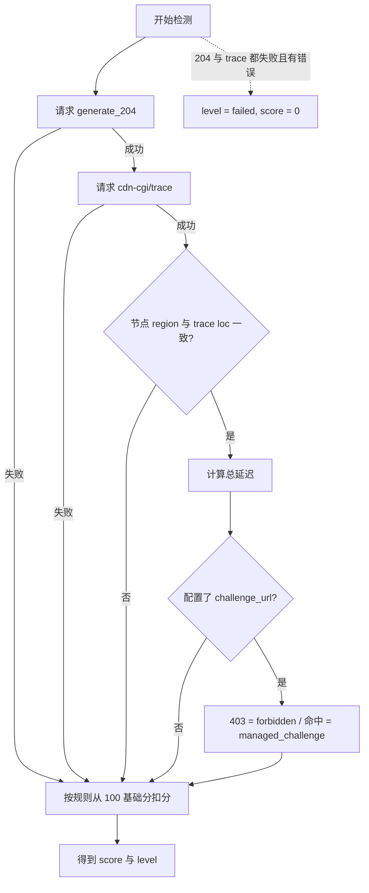

# Cloudflare 评分 / CF Score

`easy_proxies` 的 CF 评分是本地 **Cloudflare Compatibility Score**，用于评估代理节点访问 Cloudflare 网络和 Cloudflare 保护站点的兼容性。

重要说明：这不是 Cloudflare Enterprise Bot Management 的官方 Bot Score。官方 Bot Score 只有你控制的 Cloudflare Enterprise Zone 并启用 Bot Management 后，才能通过 Cloudflare 规则、日志或 Workers 读取。

相关文档：[IP_REPUTATION](IP_REPUTATION.md)（IP 信誉）、[PROXY_EXTRACTOR](PROXY_EXTRACTOR.md)（代理提取）、[README](README_ZH.md)。

## 第一版检测项

第一版默认检测：

1. Cloudflare 204 连通性
   - `http://cp.cloudflare.com/generate_204`
   - 成功条件：HTTP 204
2. Cloudflare Trace
   - `https://www.cloudflare.com/cdn-cgi/trace`
   - 解析字段：`ip`、`loc`、`colo`、`http`、`tls`、`warp`
3. 地区一致性
   - 节点 region 和 `trace loc` 是否一致
4. 延迟
   - 204 和 trace 请求总耗时
5. Challenge URL
   - 第一版默认未配置，返回 `not_configured`
   - 后续可接入你自己的 Cloudflare 测试域名



> 图：CF 评分的检测与评分流程，与代码实现（internal/cloudflarecheck）一致。

## 评分规则

基础分 100：

| 条件 | 扣分 |
|---|---:|
| `generate_204` 失败 | -30 |
| `cdn-cgi/trace` 失败 | -20 |
| `trace loc` 和节点地区不一致 | -15 |
| 自定义 challenge URL 返回 403 | -40 |
| 自定义 challenge URL 出现 managed challenge | -25 |
| 延迟超过 3000ms | -10 |

等级：

```text
80-100 excellent / 优秀
60-79  good      / 良好
40-59  fair      / 一般
0-39   poor      / 较差
failed 检测失败
```

失败规则：如果 `generate_204` 和 `cdn-cgi/trace` 都失败，并且存在具体错误信息，则统一返回：

```text
level = failed
score = 0
```

这样 WebUI 汇总、API summary 和缓存 summary 保持一致，避免把完全不可用节点误显示为“一般”。

## WebUI 使用

打开：

```text
http://127.0.0.1:9091
```

进入：

```text
节点质量（Quality）
```

CF 评分是「节点质量」页内的一个维度（与 IP 风险、综合质量并列展示）。

推荐流程：

1. 选择地区，例如 `日本(jp)`。
2. 数量选择 `5` 或 `10`（抽样样本数）。
3. 点 `抽样检测 CF` 做同步小批量检测，或点 `Pipeline 扫描 N 个节点` 创建后台全量任务。

按钮区别：

- `抽样检测 CF`：同步抽样检测当前筛选出的节点，数量受上限约束，速度快，适合快速看。
- `Pipeline 扫描`：后台全量任务，包含不可用/未探测节点，适合 6000+ 节点；结果服务端分页返回。
- `重试失败节点`：只对上次 Pipeline 失败的节点重新扫描。

页面支持：

- 按等级筛选：全部 / 优秀 / 良好 / 一般 / 较差 / 检测失败
- 排序：分数从高到低 / 延迟从低到高 / 节点名
- 单条复制代理 URL
- 单条复制 curl 命令
- 导出 CSV

结果会显示：

- 节点名
- 地区 / 本地端口
- 出口 IP
- CF loc / colo
- HTTP / TLS / WARP
- 204 和 trace 状态
- score / level
- latency / cache


## 大规模后台检测

6000+ 节点不要使用同步全量请求等待所有结果返回。节点质量页的“Pipeline 扫描”和“重试失败节点”会创建后台质量任务：

```bash
curl --noproxy '*' -sS -X POST 'http://127.0.0.1:9091/api/quality/jobs' \
  -H 'content-type: application/json' \
  -d '{"kind":"combined","region":"all","mode":"multi-port","count":6000,"include_unavailable":true,"replace":true}'
```

然后轮询进度并分页读取结果：

```bash
curl --noproxy '*' -sS 'http://127.0.0.1:9091/api/quality/jobs/<job_id>'
curl --noproxy '*' -sS 'http://127.0.0.1:9091/api/quality/jobs/<job_id>/results?page=1&page_size=100'
```

更完整的接口列表见 [README.md](README.md#management-api) 的 Management API 表格。

## API 用法

### 检查节点

```bash
curl --noproxy '*' -s 'http://127.0.0.1:9091/api/cloudflare/check?region=jp&mode=multi-port&count=10'
```

### 查看缓存

```bash
curl --noproxy '*' -s 'http://127.0.0.1:9091/api/cloudflare/cache'
```

### 清空缓存

```bash
curl --noproxy '*' -X POST -s 'http://127.0.0.1:9091/api/cloudflare/cache'
```

## CLI 用法

```bash
./epctl.sh cf:check jp
./epctl.sh cf:check all 10
./epctl.sh cf:check-all
./epctl.sh cf:check-all jp
./epctl.sh cf:cache
```

如果 WebUI 设置了密码：

```bash
WEBUI_PASSWORD='***' ./epctl.sh cf:check jp 10
```

脚本不会打印密码。

## 自有 Cloudflare Challenge 测试域名

如果你想更接近真实业务风控，可以准备一个你控制的 Cloudflare 域名：

```text
https://cf-test.example.com/
```

建议配置：

- WAF Managed Challenge
- Turnstile / Pre-clearance，可选
- Bot Fight Mode / Super Bot Fight Mode，可选

> 注意：当前版本配置中**尚未接入** `cloudflare_score` 配置段（`challenge_url` 未在配置文件中暴露，代码默认返回 `not_configured`）。下面的 YAML 仅为预留示意，实际接入方式以 release notes 为准。

```yaml
# 预留示意，尚未生效
cloudflare_score:
  enabled: true
  challenge_url: "https://cf-test.example.com/"
  timeout: 8s
  cache_ttl: 6h
```

## 常见问题

### 为什么没有官方 Bot Score？

Cloudflare 官方 Bot Score 是 Enterprise Bot Management 能力，只能在你自己的 Cloudflare Enterprise Zone 内读取。普通第三方代理 IP 无法直接查询官方分数。

### 为什么 CF loc 和节点地区不一致？

可能原因：

- 节点标签不准。
- 代理出口实际落在另一个国家。
- Cloudflare 根据 Anycast / 路由看到的出口位置不同。

### 为什么 204 成功但分数不高？

204 只说明能访问 Cloudflare 网络，不代表不会被 Cloudflare 保护站点 challenge。trace 地区不一致、延迟过高或 challenge 命中都会降低评分。

### 为什么优先用 multi-port？

multi-port 是“一端口一节点”，能对具体节点打分。pool/geoip 是聚合入口，出口可能变化，不适合保存稳定评分。


### 为什么有检测失败？

检测失败通常表示该节点无法完成 Cloudflare 204 和 trace 请求，常见原因包括：

- 节点不可用或握手失败。
- 节点 DNS / IPv6 / TLS 配置异常。
- 节点对 Cloudflare 路由超时。
- 订阅里包含说明性节点或已失效节点。

这些节点在 WebUI 中会显示为 `检测失败`，不再混入 `一般`。
