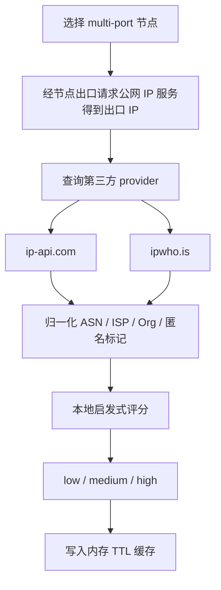

# IP 信誉检查 / IP Reputation

`easy_proxies` 增加了本地 IP 信誉检查能力，用来判断当前代理节点的真实出口 IP 是否更像住宅、机房、代理/VPN 或高风险出口。

> **现状说明（重要）**：该能力在代码中**已实现**（内置 `ip-api.com` 与 `ipwho.is` 两个 provider），但**默认运行配置未启用**：
> 它不参与任何默认后台定时任务，缓存初始为空，只有你显式调用 `/api/reputation/*` 或 WebUI「节点质量」页触发检查时才会真正请求第三方接口并产生缓存。
> 在未接入/未初始化巡检的实例上可能看到 `reputation checker is not configured` 提示，这属于"未默认启用"，不是功能缺失。

安全边界：

- 不读取或展示订阅 URL。
- 不在 API 响应里返回代理密码。
- 不硬编码第三方 API key。
- 默认只通过本地 WebUI 管理接口访问。

相关文档：[CF_SCORE](CF_SCORE.md)（CF 兼容性评分）、[PROXY_EXTRACTOR](PROXY_EXTRACTOR.md)（代理提取）、[README](README_ZH.md)。

## WebUI 使用

打开 WebUI：

```text
http://127.0.0.1:9091
```

进入：

```text
节点质量（Quality）
```

IP 信誉是「节点质量」页内的一个维度（与 CF 评分、综合质量并列展示），页面里对应「风险/IP 风险」列。

推荐用法：

1. 地区选择 `日本(jp)`、`美国(us)` 或 `全部(all)`。
2. 数量选择 `5` 或 `10`（抽样样本数）。
3. 点 `出口校准地区` 对抽样节点做同步的出口 IP 信誉检查并按出口校准地区（样本数受限）；大规模检查走 `Pipeline 扫描` 后台任务。

页面会显示：

- 节点名
- 本地端口
- 出口 IP
- 国家 / 地区
- ASN / ISP
- 风险等级
- 是否命中缓存
- 检测耗时

## API 用法

### 检查单个 IP

```bash
curl -s 'http://127.0.0.1:9091/api/reputation/ip?ip=1.1.1.1'
```

### 检查某个地区的 multi-port 节点

```bash
curl -s 'http://127.0.0.1:9091/api/reputation/check?region=jp&mode=multi-port&count=10'
```

### 查看缓存

```bash
curl -s 'http://127.0.0.1:9091/api/reputation/cache'
```

## CLI 用法

```bash
./epctl.sh reputation:check jp
./epctl.sh reputation:check all 10
./epctl.sh reputation:cache
```

如果 WebUI 设置了密码，可以通过环境变量传入，脚本不会打印密码：

```bash
WEBUI_PASSWORD='***' ./epctl.sh reputation:check jp 10
```

## 风险评分

当前基础版使用本地启发式评分：

| 信号 | 加分 |
|---|---:|
| ASN/ISP/Org 命中 hosting/cloud/datacenter 关键词 | +30 |
| Provider 判断 proxy | +40 |
| Provider 判断 VPN | +40 |
| Provider 判断 Tor | +80 |
| 节点地区和出口国家不一致 | +20 |
| 检测失败 | +50 |
| 延迟超过 3000ms | +10 |

等级：

```text
0-30   low
31-70  medium
71-100 high
```

## 检测流程



> 图：IP 信誉的检查与评分流程（与 internal/reputation 实现一致）。

## Provider

基础版内置：

- `ip-api.com`
- `ipwho.is`

后续可以扩展：

- AbuseIPDB
- IPQualityScore
- Scamalytics
- MaxMind

## 缓存

默认使用内存 TTL 缓存，避免频繁请求第三方接口。缓存内容只包含出口 IP 画像，不包含代理密码或订阅信息。

## 常见问题

### 检查失败

先确认服务运行：

```bash
./epctl.sh service:status
```

再确认节点可用：

```bash
./epctl.sh proxy:test jp
```

### 结果都是 high

常见原因：

- 出口是云服务器 / 机房 ASN。
- Provider 判断为 proxy/VPN。
- 节点标记地区和真实出口国家不一致。

### 为什么优先检查 multi-port？

multi-port 是“一端口一节点”，适合判断具体节点质量。pool/geoip 是聚合入口，出口可能变化，不适合给单个节点打稳定信誉分。
