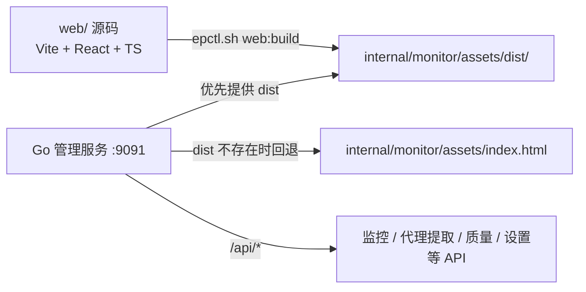

# WebUI 架构说明

Easy Proxies 当前 WebUI 采用新旧双栈过渡架构：

- 新 WebUI：`web/`，Vite + React + TypeScript。
- 构建产物：`internal/monitor/assets/dist/`。
- 旧 WebUI：`internal/monitor/assets/index.html`，作为 legacy fallback 保留。
- Go 管理服务继续监听原管理端口，并继续提供 `/api/*`。

项目总览见 [README](README.md) / [README_ZH](README_ZH.md)。



> 图：新 WebUI 的构建产物与 legacy 回退的架构关系。

## 运行方式

生产运行推荐使用本地控制脚本：

```bash
./epctl.sh service:start
./epctl.sh service:status
```

也可以直接运行本地二进制：

```bash
./easy_proxies_local --config config.yaml
```

或：

```bash
./epctl.sh start
```

访问：

```text
http://127.0.0.1:9091
```

## 前端开发

```bash
./epctl.sh web:dev
```

Vite dev server 会把 `/api` 代理到本地管理 API。

## 前端构建

```bash
./epctl.sh web:typecheck
./epctl.sh web:build
```

构建输出到：

```text
internal/monitor/assets/dist/
```

## 页面结构

新 WebUI 当前包含 9 个标签页：

1. 代理提取
2. 节点总览
3. 待确认节点
4. 节点配置
5. 节点质量
6. 运行状态
7. 日志诊断
8. API Key
9. 系统设置

页面职责：

- `代理提取`：按地区、协议格式和数量提取代理，并支持复制。
- `节点总览`：以表格展示全部节点，支持地区、可用性、延迟筛选和排序。
- `待确认节点`：确认地区归属，减少错误路由与池污染。
- `节点配置`：维护节点配置条目与重载相关操作。
- `节点质量`：自动加载 CF/IP 信誉缓存；支持全量扫描、重试失败节点，并展示 CF 分、IP 风险和综合质量分。
- `运行状态`：展示节点状态、地区可用性、实时流量和可切换时间尺度的带宽图。
- `日志诊断`：承载诊断分析、实时日志和排障信息。
- `API Key`：签发、启停和轮换访问凭证。
- `系统设置`：编辑配置并写回 `config.yaml`。

合并情况：原来的 CF 评分、IP 信誉页面并入 `节点质量`；Android 代理端口并入 `代理提取`；控制台日志并入 `日志诊断`。节点配置、待确认节点、API Key 目前仍是独立标签页。

## 安全约束

- 不在前端 console 输出真实代理、订阅 URL、token 或密码。
- 设置页默认隐藏敏感字段。
- 文档示例使用占位符，不写真实凭据。
